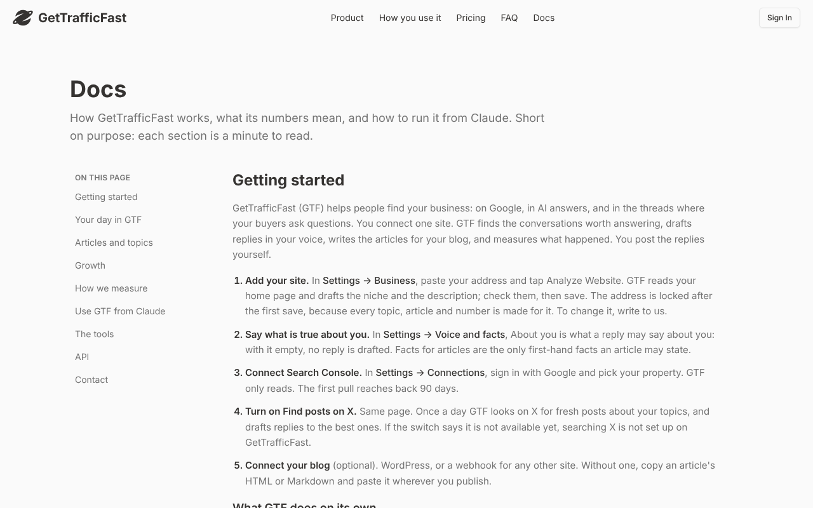
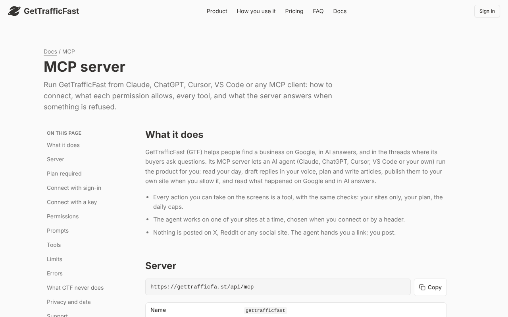
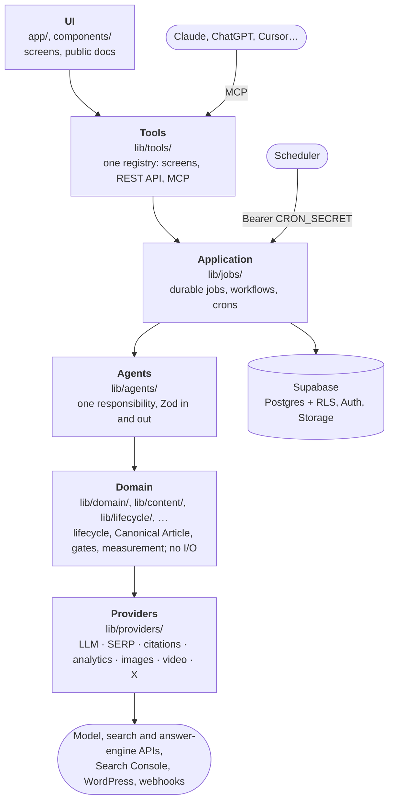

<p align="center">
  
</p>

<h1 align="center">GetTrafficFast</h1>

<p align="center">
  A content operating system for SEO and AEO: it researches, writes, publishes and measures<br>
  the content that makes a business findable on Google and inside AI answers.
</p>

<p align="center">
  <a href="https://gettrafficfa.st">Hosted service</a> ·
  <a href="https://gettrafficfa.st/docs">Docs</a> ·
  <a href="https://gettrafficfa.st/docs/mcp">MCP server</a> ·
  <a href="docs/SELF_HOSTING.md">Self-hosting</a> ·
  <a href="CONTRIBUTING.md">Contributing</a>
</p>

<p align="center">
  
</p>

## What it is

GetTrafficFast (GTF) is not an article generator. You connect one site, and
the platform runs the loop that makes that business findable, on search
engines (SEO) and in AI answer engines such as ChatGPT, Gemini and
Perplexity (AEO):

- **Research.** Keywords and questions people ask, the pages that rank for
  them, and the sources answer engines lean on.
- **Write.** Articles planned on a calendar, drafted by agents with
  schema-validated output, held back by quality gates when a fact has no
  source, and enriched with images and video.
- **Publish.** To WordPress or any site through a signed webhook, or copied
  as HTML or Markdown. Autopilot can do this on a schedule.
- **Reply.** GTF finds fresh conversations on X and Reddit where your buyers
  ask questions and drafts replies in your voice, from facts you confirmed.
  **It never posts on its own.** A person reads the draft and posts it; on X,
  a reply to a post that mentions the site's connected X account can be
  posted from it with one press of Post on X.
- **Measure.** Google rank and clicks from Search Console, index status,
  and whether answer engines cite your pages. Citations are **sampled, per
  engine**: no engine exposes "was I cited" as an API, so GTF asks real
  questions on a rotating schedule, stores the answers whether or not you
  were cited, and never averages engines together. A rate with no samples
  is shown as "not measured yet", never as 0%.

Everything you can do on a screen you can also do from an agent, through
the MCP server or the REST API.

| | |
|---|---|
|  |  |
| Public docs: `/docs` | MCP reference: `/docs/mcp` |

## Hosted service or self-hosted

**Hosted** at [gettrafficfa.st](https://gettrafficfa.st): sign in, connect a
site, and everything below is configured for you, including the providers,
the crons and the measurements.

**Self-hosted**: this repository is the whole product. You bring a Supabase
project, a host for a Next.js app (Vercel is what it is built for), and API
keys for the providers you want. Billing can be switched off
(`BILLING_DISABLED=1`), and every paid provider is opt-in. The step-by-step
guide is [`docs/SELF_HOSTING.md`](docs/SELF_HOSTING.md).

If you run a modified version as a service, the AGPL asks you to publish
your changes, and the trademark policy asks you to rename it (see
[License](#license-and-trademarks)).

## Use it from an agent (MCP)

GTF is an MCP server. Claude, ChatGPT, Cursor, VS Code or any MCP client can
read your day, draft and fix replies, plan and write articles, publish them
when you allow it, and read the results, with the same permission checks as
the screens. Sign in with OAuth or use an API key from Settings.

```sh
claude mcp add --transport http gettrafficfast https://gettrafficfa.st/api/mcp
```

The full reference, with every tool, permission, limit and error, is at
[gettrafficfa.st/docs/mcp](https://gettrafficfa.st/docs/mcp). Agent skills
and a Claude Code plugin live in [`distribution/skills/`](distribution/skills/)
(MIT licensed).

## Architecture

**Orchestration is code, steps are agents.** What runs, in what order and
what happens on failure is plain TypeScript with tests; each step is an
agent whose input and output are validated with Zod. Nothing decides "what
to do next" by prompting a model. Layers depend downward only, and no
vendor name appears above the provider layer, so swapping a vendor is a
setting.



The reference is [`docs/ARCHITECTURE.md`](docs/ARCHITECTURE.md); the
engineering rules are [`AGENTS.md`](AGENTS.md).

## Tech stack

| | |
|---|---|
| App | Next.js 16 (App Router), React 19, TypeScript, Tailwind CSS, Radix UI |
| Data | Supabase: Postgres with row-level security on every table, Auth, Storage |
| Validation | Zod at every boundary: agent I/O, API, MCP tools |
| Models | Gemini by default, Anthropic Claude as fallback or writer, behind one provider interface |
| Jobs | A durable job runner on Postgres, ticked by cron (`lib/jobs/`) |
| MCP | `@modelcontextprotocol/sdk`, Streamable HTTP, OAuth 2.1 and API keys |
| Billing | Stripe (optional for self-hosting) |
| Observability | Sentry (optional) |
| Tests | Vitest, no network and no secrets |
| Hosting | Vercel, with Vercel Cron |

## Quick start (development)

Requirements: Node.js 22 (`.nvmrc`) and npm.

```sh
git clone https://github.com/egidiosalinaro/gettrafficfast.git
cd gettrafficfast
npm ci
npm test            # the whole suite runs with no environment at all
```

To run the app you need a Supabase project with the migrations applied and
at least the Supabase and Gemini keys:

```sh
cp .env.example .env.local    # fill in NEXT_PUBLIC_SUPABASE_URL, the keys, GEMINI_API_KEY
echo "BILLING_DISABLED=1" >> .env.local   # no Stripe needed locally
npx supabase link --project-ref <your-project-ref>
npx supabase db push          # applies supabase/migrations/ in order
npm run dev                   # http://localhost:3000
```

Before you open a pull request:

```sh
npm run lint && npx tsc --noEmit && npx vitest run
```

## Documentation

- [`docs/ARCHITECTURE.md`](docs/ARCHITECTURE.md): the target architecture and how the code maps onto it
- [`AGENTS.md`](AGENTS.md): the engineering rules, for people and coding agents
- [`docs/SELF_HOSTING.md`](docs/SELF_HOSTING.md): running your own deployment
- [`docs/`](docs/): one document per subsystem, for example
  [content pipeline](docs/CONTENT_PIPELINE.md),
  [agent runtime](docs/AGENT_RUNTIME.md),
  [citations](docs/CITATIONS.md),
  [replies on X and Reddit](docs/PLACEMENTS.md),
  [API and MCP](docs/API.md),
  [integrations](docs/INTEGRATIONS.md)
- Product docs for users: [gettrafficfa.st/docs](https://gettrafficfa.st/docs)

## Contributing

Contributions are welcome. Read [`CONTRIBUTING.md`](CONTRIBUTING.md) first:
it covers the setup, the checks CI runs, the rules a change has to respect
(honest measurements, cost opt-in, layers, Zod at boundaries) and how a pull
request gets reviewed. Every commit needs a DCO sign-off (`git commit -s`).
Please follow the [Code of Conduct](CODE_OF_CONDUCT.md), and report security
problems privately as [`SECURITY.md`](SECURITY.md) describes.

## License and trademarks

GetTrafficFast is licensed under the
[GNU Affero General Public License v3.0](LICENSE) (`AGPL-3.0-only`). If you
run a modified version as a network service, you must offer its source to
its users.

- [`distribution/skills/`](distribution/skills/) is MIT licensed
  ([its LICENSE](distribution/skills/LICENSE)).
- The GetTrafficFast name and logo are **not** licensed for use by forks:
  rename yours. See [`TRADEMARKS.md`](TRADEMARKS.md).
- Third-party logos in `public/` belong to their owners and are outside the
  license. See [`NOTICE`](NOTICE).
